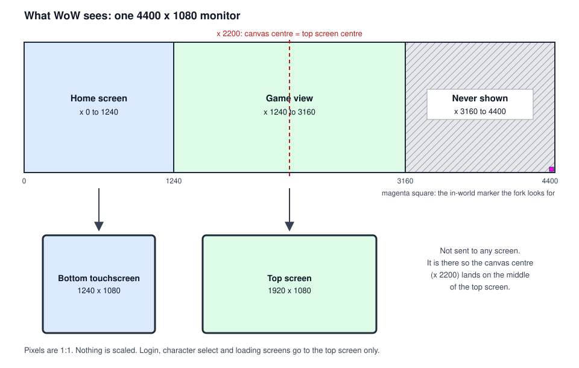
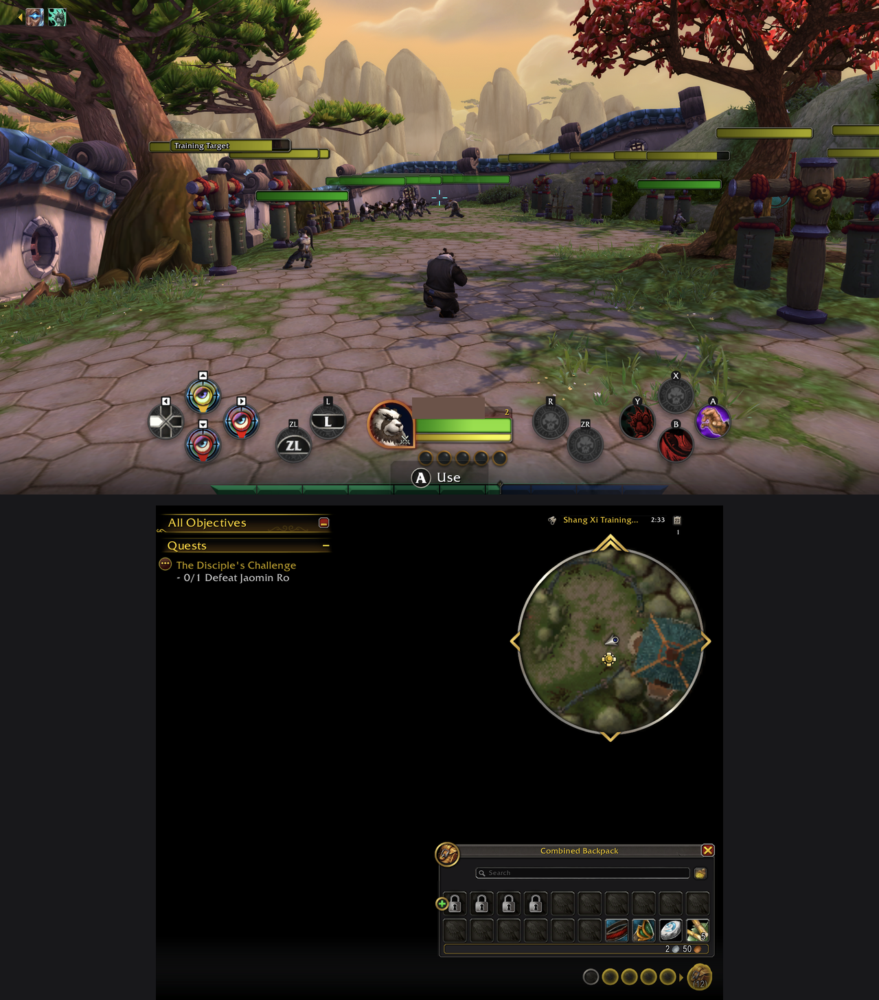

# Dual screen

What I wanted: the game on the Thor's top screen and WoW's own windows (bags, map, chat, quest tracker) on the bottom touchscreen, with touch working on the bottom screen.

This page describes the current layout: FFSpan 2.9.0<!-- VERSION -->, FFScale 1.11.0<!-- VERSION --> and FFBinds 1.8.4<!-- VERSION -->, with fork patches 01 to 11. It runs on Retail, MoP Classic and the Forever beta. Parts of it are still being changed, and I say which below.

## The canvas

Wine gives WoW one monitor, so WoW never knows there are two screens. I made that monitor 4400 x 1080 and show different parts of it on each screen:

- **x 0 to 1240** goes to the bottom touchscreen (1240 x 1080). I call this the home screen.
- **x 1240 to 3160** goes to the top screen (1920 x 1080). This is the game.
- **x 3160 to 4400** isn't shown on either screen.

Both screens are 1080 pixels tall and nothing is scaled, so pixels stay 1:1.

The unshown strip is there for the centre. WoW puts a lot of things at the centre of its window: the point the camera aims at, most dialogs and popups, and ConsolePort's crosshair, which ConsolePort anchors to the bottom centre of the screen (`View/Cursors/Crosshair.lua` in [ConsolePort](https://github.com/seblindfors/ConsolePort)). If the game view sits at one side of a wider canvas, the aim point and the crosshair land off to the side of it. With 4400 pixels the centre is x 2200, which is the middle of the top screen (1240 + 960).

FFSpan works the regions out from the size WoW reports, it doesn't hard-code them. The game view is 1080 x 16/9 = 1920 wide and sits in the middle, and each side gets (4400 - 1920) / 2 = 1240. That's why 4400: the left-over strip is exactly as wide as the bottom screen. FFSpan only acts on a 3160 x 1080 or 4400 x 1080 canvas, and does nothing at 1920 x 1080.

## Glue mode

Login, character select and loading screens don't span. WoW draws them in a centred 16:9 area, which on the 4400 canvas is exactly the top screen. The fork shows them on the top screen only and keeps the bottom screen black.

To know when you're in the world, the fork looks for a marker. FFSpan draws a 6-pixel magenta square in the bottom-right corner of the canvas while the in-world UI is up, and hides it on loading screens and movies. The fork samples that corner. Marker there = in the world, both screens. No marker = glue mode, top screen only. The corner is in the unshown strip, so the marker never appears on either screen.

On my device, login, character select and loading screens showed on the top screen only, with the bottom screen black, on both the 3160 and the 4400 layouts.

## The home screen

The bottom screen has one fixed layout. FFScale sets it up as a second Edit Mode layout (`ThorSpanHome`), and FFSpan keeps the bags open and places windows on top of it.

This is my Thor the first time the home layout ran, with FFSpan 2.2.1, an earlier version than the one in this repo. Top screen: the game, with ConsolePort's action bars in the middle. Bottom screen: quest tracker, minimap and bags. My character's name is blanked out.

- **Quest tracker** top-left.
- **Minimap** top-right, bigger than on the single-screen layout (Edit Mode size 130% with Baganator, up to 150% with Blizzard's bags).
- **Bags, always open,** in a column under the minimap. With Baganator the column is only as wide as the current character's bags need at normal icon size, from the minimap's width (362 px) up to 70% of the screen (868 px). The tracker and chat get the rest, so a character with small bags keeps a wide tracker and chat. In the tests, a character with every bag slot filled needs the full 868 px and the icons still come out at about 0.73x. With Blizzard's bags, FFSpan caps the column at 55% of the screen. Since FFSpan 2.9.0, with Baganator, the bags come straight back when something closes them (their own close button, Escape, the Shop), or after the fight in combat. With Blizzard's bags you can still put them away.
- **Chat** bottom-left. With Glassy, since FFSpan 2.9.0, it dims to 45% when nothing is happening, and goes back to full for 10 seconds after a message, while you type and while you touch it. It doesn't dim with Blizzard's chat. `/ffspan chatdim on|off|<0.1 to 1>` changes it.
- **Micro menu** (Retail) in a wide bar along the bottom edge. While the home screen is on, FFSpan takes the micro buttons back from ConsolePort's toolbar and FFScale places them.

With Baganator, Blizzard's bag bar is moved into the unshown strip, because Baganator draws its own bag slots. FFSpan also takes the always-open bags and the map out of ConsolePort's gamepad cursor (ConsolePort's `RemoveInterfaceCursorFrame`), so opening them doesn't pull the cursor off the game.

With Glassy, the chat sits flush on the bottom edge of the screen. Blizzard's chat keeps a 16 px margin. Before FFScale 1.8.3 a full-height quest tracker could overlap the top of a tall chat skin. The tests now check that the tracker at its full Edit Mode height ends above the chat for every bag-column width. I haven't checked the fix on my device yet.

### Where windows open

FFSpan sorts the windows it manages into three size classes. Each window is scaled to fit its area and can grow up to that class's cap.

| Class | Where | Cap | Windows |
|---|---|---|---|
| TOP | The top screen, inside a 16 px margin | 1.25x | Game menu, settings, shop, talents |
| PAGE | The whole bottom screen, one at a time | 1.5x | Map, spellbook, collections, achievements, professions, adventure guide, group finder, communities, calendar, friends, wardrobe, housing dashboard |
| COMPANION | The bottom screen, left of the bags. The bags stay open. | 1.25x | Character, vendor, mail, bank and warband bank, guild bank, trade, auction house, socketing, item upgrade |

- Talents and the spellbook are one Blizzard window. FFSpan sends it to the top screen while the talents tab is showing and to the bottom screen for the spellbook.
- When a companion window opens, the bag column narrows so the window can be bigger.
- Windows FFSpan doesn't manage stay where WoW puts them. For most dialogs and popups that's the canvas centre, which is the top screen.
- FFSpan waits for FFScale to confirm the layout is applied and to measure where the minimap and the bottom bar are before it places anything. If FFScale doesn't confirm the layout, FFSpan says so in chat. If it has to estimate the edges, it notes that in its log.
- Window placement hooks WoW's global `UpdateUIPanelPositions`. In combat, a newly opened window stays where WoW put it and is moved after combat, because an addon can't move protected frames in combat.
- **Tap outside a window to close it.** Since FFSpan 2.8, while a menu window ([controls](controls-and-ui.md)) is open, a tap on an empty part of the bottom screen closes the newest one. That includes the Shop on the top screen, which ConsolePort's cursor can't reach. A drag doesn't count, and in combat a tap does nothing. `/ffspan dismiss on|off|status` turns it on or off. On my device a tap closed a page window and the Shop. Page windows leave only thin strips to tap.

The map sits at the top of the bottom screen, full width, and gets taller when its quest panel is hidden. If you turn on Leatrix Maps' own Unlock Map or Scale World Map options, FFSpan leaves the map alone for that session and says so in its log. I haven't checked the map's final size on my device yet.

`FFSpan_Dump.lua` saves labelled snapshots of every frame's position (`/ffspan dump <label>`) into `FFSpanDB`, so I could check layouts from the saved file.

## Touch

The fork puts a touch view on the bottom screen that maps each touch to the matching point of the canvas:

- **Tap** = left click.
- **Drag** = drag with the left button held.
- **Long press** (300 ms) = right click.
- **Two-finger drag** = mouse wheel, on both screens (patch 11). On the top screen this applies when the container has span mode on and no two-finger setting of its own. Over the 3D world the wheel zooms the camera. On my device two-finger scrolling worked on the top screen (the Shop). I didn't check it separately on the bottom screen.

## Third-party addons

The current layout is built around addons other people made. This guide doesn't include any of them. Get them from their official pages.

| Addon | What I use it for | License | Version I tested |
|---|---|---|---|
| [ConsolePort](https://github.com/seblindfors/ConsolePort) | Controller UI, crosshair, the menu ring on the `-` button ([controls](controls-and-ui.md)) | Artistic-2.0 | 3.2.5 |
| [Baganator](https://www.curseforge.com/wow/addons/baganator) | The always-open bags. Needs Syndicator. | All Rights Reserved | 829 |
| [Syndicator](https://www.curseforge.com/wow/addons/syndicator) | Required by Baganator | All Rights Reserved | 282 |
| [Leatrix Maps](https://www.curseforge.com/wow/addons/leatrix-maps) | The map. I use its default settings, which don't move or scale the map window. | All Rights Reserved | 12.1.06 |
| [Glassy](https://github.com/Solessfir/Glassy) | Chat skin. FFSpan places Glassy's chat through Glassy's own mover. Optional. | MIT | 1.9.4 |
| [Immersion](https://github.com/seblindfors/Immersion) | Quest dialogue. Optional. | Artistic-2.0 on GitHub, All Rights Reserved on CurseForge | 1.4.59 |

FFSpan and FFScale also work with Blizzard's own bags and chat. Without Baganator the bags use Blizzard's bag windows and bag bar, and the minimap starts at 150%.

If you use [TalentTreeTweaks](https://www.curseforge.com/wow/addons/talent-tree-tweaks) (All Rights Reserved, I tested v1.14.0), turn off its Scale Talent Frame module (see below).

The picker's backend ([launcher.md](launcher.md#the-wow-dual-screen-picker)) also patches a few lines in three of these addons on every launch, for errors I hit:

- **Syndicator, on Forever.** Forever renamed an English stat label, and a check in Syndicator's item search then fails on an English client, which stops Syndicator loading. My copy of the backend changes that one `assert` in `Search/CheckItem.lua` so it doesn't fire on Forever. Syndicator is All Rights Reserved, so that edit isn't in this repo.
- **ConsolePort, on Forever.** Lua errors from its housing menu entry (Forever has the housing button but not `HousingFramesUtil`) and from flyout slot counts (`GetFlyoutInfo` succeeds without returning a count).
- **Glassy.** A chat dock anchor-cycle Lua error at startup, which I saw on Forever. The edit applies where Glassy treats the client as retail, which includes Forever, and leaves Classic alone.

The ConsolePort and Glassy edits are in [patches/addons/](../patches/addons/README.md) as small diffs, and the public `wowgo.sh` makes them on launch, only when it finds the exact original lines, after backing up each file. The Syndicator one is described above and isn't included.

### Checking the versions I tested

You download these addons from their authors' own pages. This repo never ships their files, only the small fixes in [patches/addons/](../patches/addons/README.md). Baganator, Syndicator, Leatrix Maps and TalentTreeTweaks are All Rights Reserved, and the others aren't mine to hand out either. What the repo has is [addons/third-party.json](../addons/third-party.json): each addon's name, author, license, official page, the version I tested and a checksum of the files I tested.

[tools/addons/check_addons.py](../tools/addons/check_addons.py) checks your copies against those checksums. It needs Python 3 and nothing else. It can also install a zip you downloaded and change the one setting below. It never downloads anything and never copies an addon to the Thor.

- **`check`.** `python tools/addons/check_addons.py check <your AddOns folder> --profile dual` prints OK, DIFFERENT VERSION, DIFFERENT FILES or MISSING for each addon, and MISSING REQUIREMENT if Baganator is there without Syndicator. It also compares FFSpan, FFScale and FFBinds with this repo's copies. DIFFERENT FILES means the version number matches but the files don't. That's probably fine. It just isn't the exact build I tested. With `--adb` instead of a folder it reads the AddOns folder on the Thor, and only reads.
- **`install`.** `install <the zip you downloaded> <your AddOns folder>` unpacks your own download into your own folder on the PC. It only takes the exact zip I tested, matched by its sha256. I kept those for Baganator, Syndicator and Leatrix Maps. Any other zip, including a newer version, is refused, and you unzip it yourself. It won't overwrite a folder unless you add `--replace`.
- **`settings`.** `settings <your WTF folder>` reads a copy of the WTF folder on your PC and tells you whether TalentTreeTweaks' Scale Talent Frame is off. `--apply` prints the one line it would change and writes nothing. `--apply --write --wow-closed` makes the change. Before it writes, it copies the file to `<file>.bak-<date>-<time>` next to it. Only that one value changes. The rest of the file stays byte for byte the same.

The script can't see whether WoW is running on the Thor, so `--wow-closed` is you telling it WoW is closed. Close WoW before you copy the WTF folder off the Thor, and keep it closed until the file is back. WoW writes its SavedVariables when it exits, and the old value would come back. The in-game way is simpler: type `/ttt`, find Scale Talent Frame and untick it.

I tested these versions on my device only. When an addon updates, I don't know whether it still works until I try it.

## Status

Every result here is from my own device.

| Version | Layout | Result on my device |
|---|---|---|
| Fork patches 01 to 08 | 3160 x 1080 canvas, game view at x 0 to 1920 | Glue mode worked: login, character select and loading on the top screen only. The game view wasn't centred, which is what patch 09 fixed. |
| Fork patch 09, FFSpan 2.0.0 (not in this repo) | 3160 x 1080. Top = canvas x 620 to 2540. Bottom = the two side strips. | In the world: crosshair at the true centre, ConsolePort's bars centred on the top screen, tracker and buffs on the left strip, minimap and bags on the right strip. Wide windows such as the map and the character pane crossed x 620 and were split across the two screens. |
| Fork patch 10, FFSpan 2.2.1, FFScale 1.7.0 | 4400 x 1080 home screen | The layout applied from measured positions, not estimates. Problems: the game menu ran off the bottom screen, the character pane came out small, talents and spellbook were split across both screens, the micro menu wasn't visible and the chat skin ran below the screen. |
| FFSpan 2.3.0 to 2.4.0, FFScale 1.7.1, FFBinds 1.1 | Same | Installed. I replaced each within the hour, so I didn't play-test them separately. |
| FFSpan 2.5.1, FFScale 1.8.1, with Baganator | Same, bag column sized to the bags | The `-` button opened ConsolePort's ring. No bags on screen, because Syndicator wasn't installed (see below). Talents still split (see TalentTreeTweaks below). Professions, collections, achievements, calendar, housing and friends came out well placed and sized. |
| FFSpan 2.5.2 and 2.5.3, FFScale 1.8.2 and 1.8.3, FFBinds 1.2 and 1.5 | Same, with Syndicator, Leatrix Maps, and TalentTreeTweaks' Scale Talent Frame off. The `-` button goes back one step, the map sits at the top, the Glassy chat sits on the bottom edge. | Installed. |
| FFSpan 2.5.5, FFScale 1.8.5 and 1.8.6, FFBinds 1.5, with the [picker app](launcher.md#the-wow-dual-screen-picker) | Same, on all three flavors | 24 September 2026: in the world on Classic, Retail and Forever, each started with one tap through [Battle.net](battle-net.md). That evening Forever and Retail also logged in through Direct. Forever's world came out stretched until the backend removed its inherited window-size settings, and it showed addon errors. On Retail the bags were missing. |
| FFSpan 2.5.6 to 2.8.1, FFScale 1.8.7 to 1.10.2, FFBinds 1.6 to 1.8.3 | Same | Installed one after another on 25 September. I replaced each within hours, so I don't list them separately. |
| FFSpan 2.9.0<!-- VERSION -->, FFScale 1.11.0<!-- VERSION -->, FFBinds 1.8.4<!-- VERSION -->, fork patch 11 | Same, with the bags always open, the chat dimming, tap to close and two-finger scrolling | 25 September 2026, in the world on Retail, MoP Classic and Forever with FFSpan 2.9.0 and FFBinds 1.8.4. The bags stayed open through their own close button and the Shop, a tap closed the Shop on Retail and Classic, and the chat dimmed and came back. On Forever the Shop is disabled. These checks were standing still. Earlier that day I played Retail by hand with FFBinds 1.8.4. FFScale 1.11.0 went on after that check, and the target-of-target showed beside the target. |

Every in-world result in this table is from my rooted fork. The no-root Span Test build (patch 12) and the standalone build ([below](#getting-it-on-the-device)) only got as far as the login screen on my device.

Known open issues on my device:

- The target's cast bar still hangs over the player frame.
- On Classic, a spot at the top left of the bottom screen doesn't take taps. I haven't found what takes them.
- ConsolePort's floating button icon next to its cursor can sit across the edge between the two screens.
- On Forever, ConsolePort's keyboard ring crosses into the bottom screen when chat opens.
- Once on Retail, WoW showed a popup saying TalentTreeTweaks had been blocked from an action. I couldn't make it happen again and don't know the cause.

I haven't seen the group finder or guild and communities windows placed. My test character was a Pandaren still on the starting island, so it hadn't picked a faction yet, and Blizzard disables both windows for a character without a faction. Since 24 September I've run the dual-screen layout on Retail, MoP Classic and Forever.

## Getting it on the device

- **The fork.** I don't provide an APK of it, because GameNative contains closed-source parts I don't have the right to redistribute (see `THIRD_PARTY_NOTICES` in [GameNative's repo](https://github.com/utkarshdalal/GameNative)). To build it yourself:
  1. Clone [GameNative](https://github.com/utkarshdalal/GameNative) and run `git checkout aa03ebc0`. That's the commit the patches were made against, 15 commits before the v1.2.1 tag, and I built my `span` and `spantest` apps from it. All 12 patches also apply cleanly to v1.2.1 (`git apply --check`), but I haven't built from the tag.
  2. `git apply` [patches/gamenative/](../patches/gamenative/) 01 to 11, in order. For the experimental no-root build, also apply 12.
  3. With JDK 17 and the Android SDK installed, run `./gradlew :app:assembleLegacySpan` (the legacy flavor, not the modern one). For the no-root build, run `./gradlew :app:assembleLegacySpantest` instead.
  4. Install the APK you built, for example with `adb install`.
- **The standalone variant.** [patches/gamenative-standalone/](../patches/gamenative-standalone/) goes on top of patch 12: span mode only at a 4400 x 1080 screen size, a build without GameNative's closed-source parts (`remove-blobs.sh`), and a neutral app id (`io.github.example.wowspan`). On my device that build reached the WoW login screen in span mode, without root. Its first Play hung for over 20 minutes in a one-time Mono install. Details are in [patches/README.md](../patches/README.md).
- [launcher/scripts/migrate_to_span.sh](../launcher/scripts/migrate_to_span.sh) copies the WoW container and the needed Wine pieces from stock GameNative to the fork. It copies a selected ~5 GB, not GameNative's whole 124 GB shared image folder.
- [launcher/scripts/set_span_geometry.sh](../launcher/scripts/set_span_geometry.sh) `home` sets the container to 4400 x 1080 with the home screen on the bottom. `centre` switches back to the 3160 layout. `--dry-run` reads the device and writes nothing. Root. If you run it from Git Bash on Windows, don't export `MSYS_NO_PATHCONV` yourself. The script sets it for each adb call, and with it exported the script stops before writing anything.
- The fork has the same problem as stock GameNative: it overwrites the game's ARM64 DLLs on every launch. [launcher/scripts/wow-gl-fix-span.sh](../launcher/scripts/wow-gl-fix-span.sh) is a Magisk boot script that copies them back every 0.3 s. Without it the game says "Your 3D accelerator card is not supported". Root.
- The "WoW Dual Screen" picker app and its backend `wowgo.sh` are how I start it now: one tap per flavor, Direct or Battle.net ([launcher.md](launcher.md#the-wow-dual-screen-picker), [battle-net.md](battle-net.md)). Root. Before the picker, the launcher tile ran [launcher/scripts/wowspan.sh](../launcher/scripts/wowspan.sh). It checks WoW isn't already running, runs the normal launcher's preparation steps, then launches the fork on the top display. Root.
- **Addons.** Copy [FFSpan](../addons/FFSpan/), [FFScale](../addons/FFScale/) and [FFBinds](../addons/FFBinds/) into the game's `Interface/AddOns` folder, and install the third-party addons above yourself. The picker's backend won't start a flavor without FFSpan, FFScale, FFBinds, Syndicator and Baganator in it.

### Without root (experimental)

My own dual-screen setup uses root for three things: a boot script that copies the ARM64 DLLs back, a script that writes the span settings into the container file, and the launcher tile. I tried whether a build of the fork can do without all three.

Patch **12** adds a separate test build, `spantest` (app `app.gamenative.spantest`, label "Span Test"), where span mode and the home-screen layout are on by default. Every other build keeps the old default, off. A span setting written into a container still wins over the default.

With that build, the only dual-screen setting is one GameNative already has in its own menus: **Edit container** > **Screen Size** > **Custom**, 4400 x 1080. At that size the default top width of 1920 puts the top screen at x 1240 to 3160 and the home screen at x 0 to 1240. The DLL problem is handled the same way as on the [quick path](quick-path.md): import the Wine, DXVK and driver files through the app's menus.

What I tested on 23 September 2026, with no root involved:

1. Installed the Span Test build next to stock GameNative and my rooted fork. Its first screen asks for a Steam login, and **Skip login** works.
2. Imported the three files through its Settings, the same menus as the quick path.
3. Added `Games/WoW` as a custom game. Set Wine, the executable (`_retail_/Wow-ARM64.exe` from the list), the driver, DXVK, and Screen Size Custom 4400 x 1080. The Display Renderer was already Vulkan, which span mode needs. The Custom size dialog didn't keep my height the first time, so check it after saving.
4. Pressed Play 3 times. Each time the log showed span mode at 4400 x 1080 with the home-screen layout and glue mode, and the login screen came up on the top screen. The first Play installed some components first and took about a minute.

I didn't log in from it, because it shares my game folder. So I haven't seen the home screen in the world with this build yet. During the login screen, my bottom screen showed AYN's own control panel instead of black. GameNative gives a folder the same game id in every app it's added to, so this build's entry had the same id as my rooted one. It lives in the test app's own data, so my root scripts, which name the other apps' folders, don't touch it.

### The fork changes

The patches are in [patches/gamenative/](../patches/gamenative/), one file per commit, in order, made against GameNative commit aa03ebc0 (the legacy flavor, `targetSdk 28`), 15 commits before v1.2.1. All the changes are Java/Kotlin. GameNative's Vulkan renderer library is prebuilt, so there's nothing native to rebuild. The fork installs next to normal GameNative as a separate app (`app.gamenative.span`, label "GameNative Span") with its own data. Stock GameNative is untouched and still works.

- **01** A `span` build type with `applicationIdSuffix .span`, so it installs side by side.
- **02** Span mode. A second `XServerView` on an Android `Presentation` on the bottom display (display id 4 on my Thor). It's a mirror: the main renderer passes every frame to it in the same call, before the frame's buffer goes back to Wine. A second touch view on the bottom screen maps taps into the matching part of the Wine canvas. Paths that were hardcoded to `app.gamenative` now use the build's own application id.
- **03** Fixes from a code review: re-create the Presentation if Android dismisses it, a timeout-safe release, and clearing the touch region on detach.
- **04** The fork can't decrypt the stock app's stored Steam login (Android Keystore keys are per app), and crashed on it. It now treats that as logged out. The fork isn't logged into Steam, and WoW's launch path doesn't need it.
- **05** A race when creating the gamepad shared-memory folder on first launch.
- **06** The controller was dead in the fork: the gamepad shim library defaults to the stock app's folder. The fork now sets `EVSHIM_BASE_PATH` to its own folder in the app process too, not only in Wine.
- **07, 08** Glue mode and the marker probe (above).
- **09** Centre-game layout: the top screen shows the middle of a 3160 canvas and the bottom screen shows both side strips.
- **10** The home-screen layout (`spanBottom=left`: the bottom screen shows the left strip only) and the bottom-screen touch gestures, including long press as right click.
- **11** Two-finger drag as the mouse wheel on both screens (above).
- **12** Experimental: the `spantest` build type, span mode and the home-screen layout on by default so no container edit is needed (above).

## Things I learned the hard way

- **Anything that takes over the top screen while the game world loads can get the game killed.** Loading into the world briefly runs the Thor out of memory, and Android kills anything not in the foreground. If GameNative is paused at that moment, Wine and WoW die with it, with no crash dump. See the Magisk note in [what-you-need.md](what-you-need.md).
- **Stock GameNative and the fork share one WoW install.** Addons, saved variables and `Config.wtf` are the same files. Any addon change for dual screen has to leave normal single-screen play alone. FFSpan only acts on the 3160 and 4400 canvases, and FFScale's single-screen layout is checked against saved test output so it doesn't change.
- **The login screen doesn't span the canvas.** It sits in a centred 16:9 area, so on the first layout the login form was split across the two screens. Glue mode fixed that.
- **As far as WoW knows, it's one wide screen.** Blizzard's code picks the side a tooltip opens on by comparing its owner's position with half the screen width. At 4400 that's wrong at the inner edges of each screen, and bag tooltips opened off the bottom screen. FFSpan moves tooltips and context menus back onto their owner's screen after whoever owns them has positioned them.
- **Baganator needs Syndicator.** Baganator's TOC lists Syndicator as optional, but without it Baganator stops while loading and prints a message asking you to install Syndicator. On my device that left no bags on screen, because FFSpan had seen Baganator and stood Blizzard's bags down. FFSpan now checks that Syndicator is loaded before it counts Baganator as usable.
- **TalentTreeTweaks' Scale Talent Frame module fights any other scaling of the talents window.** It hooks the window's `SetScale` and puts its own saved scale back, which also defeats Blizzard's own fit-to-screen scaling. On my device the talents window stayed at full size and ran across both screens. I turned that one module off. FFSpan doesn't change TalentTreeTweaks' settings. It only names it in its log when it finds it.
- **Glassy's chat frame follows its own mover, not Blizzard's chat frame.** Moving the chat frame in Edit Mode left Glassy's frame where it was, running off the bottom of the screen. FFSpan now places it through Glassy's own mover.
- **ConsolePort moves the micro menu buttons into its own toolbar** (`ConsolePort_Bar/View/Toolbar/Toolbar.lua` in ConsolePort). On my device that toolbar sat on the top screen, so the micro menu didn't show on the home screen. I used ConsolePort's menu ring instead. Since FFSpan 2.7.0 the home screen takes the micro buttons back while it's on (above).
- **Offhand.** I first used the Offhand addon for the bottom-screen UI. Even when disabled, it reset the game view's position and turned on `rawMouseEnable` at every login. I removed it from my install. It isn't included here and isn't needed. FFSpan still turns it off if it finds it, by setting its `enabled` flag before Offhand reads it, and the picker's backend moves it out of the AddOns folder.
