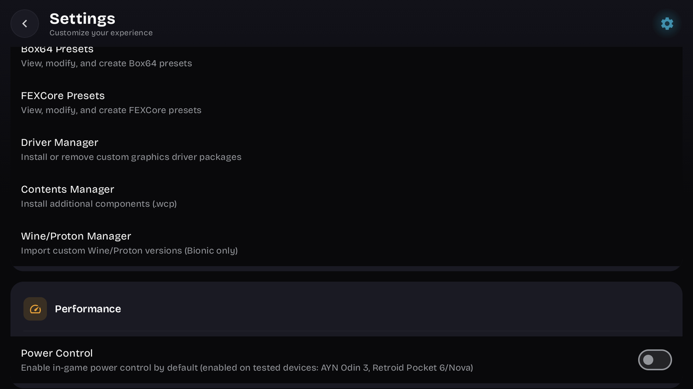
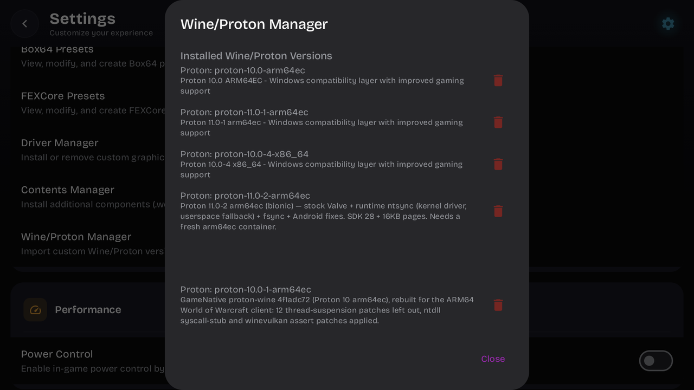
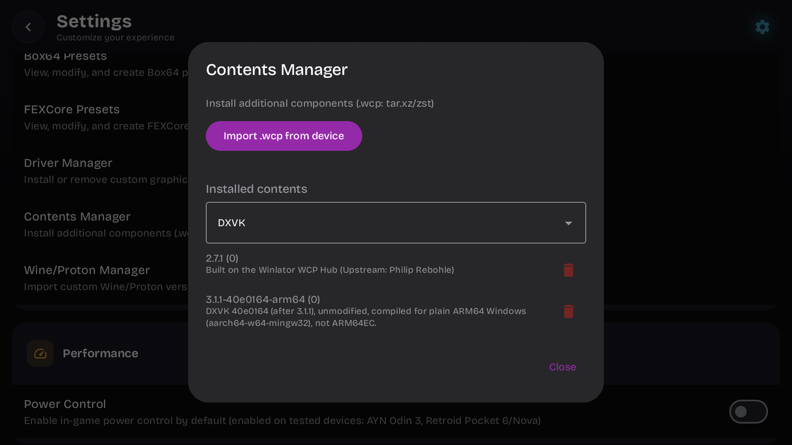
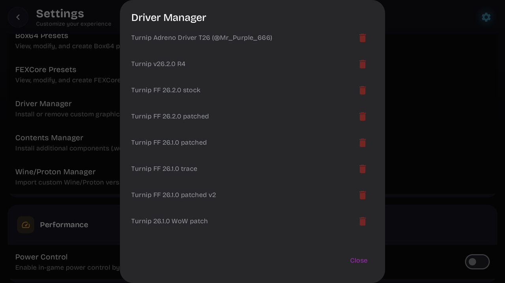
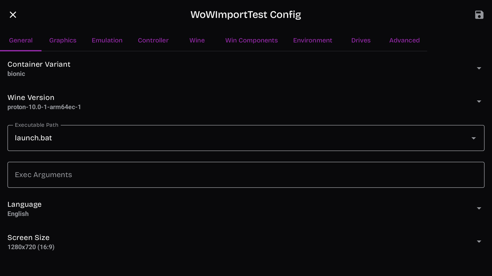
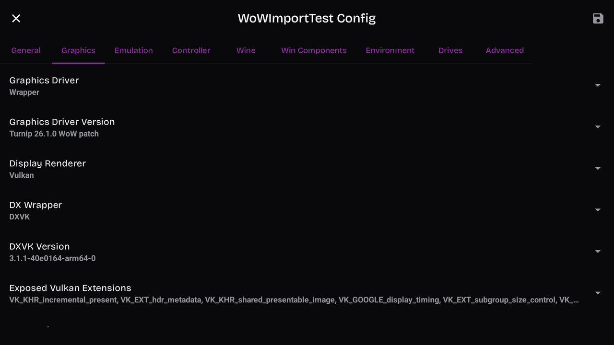
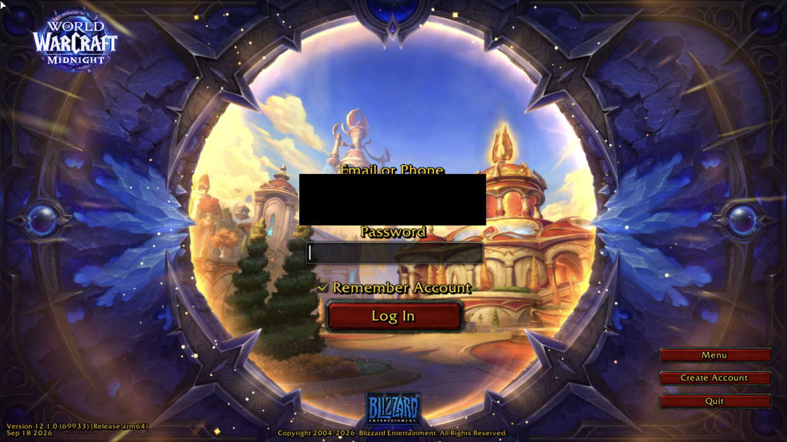

# Quick path: retail WoW on the Thor, no root

This is the short version of the guide: retail, one screen, no root. Classic, the launcher and dual screen are on the other pages.

I tested steps 4 and 5 without root: 3 of 3 cold starts reached the login screen. Details are in [What I tested](#what-i-tested) at the bottom.

## Credits

Nothing on this page is mine except the fixes, two small addons and some config files. It runs on GameNative, Wine and Proton, DXVK, Mesa's Turnip driver, TACTTool and ConsolePort. Who made each one, its license and what I changed: [CREDITS.md](../CREDITS.md).

## The files

I don't provide these three files. You build them yourself with the scripts in this repo. They're the files I put together for my own setup. It isn't a release and I'm not maintaining it as one. I've only tested them on my own device.

Each file says what it's built from. The DXVK and Turnip files include their license. The Wine package's license files are in the source archive the release script writes next to it. Nothing from Blizzard goes into them, and there's no app or installer, just the pieces. [tools/proton/build.sh](../tools/proton/build.sh), [tools/dxvk/build.sh](../tools/dxvk/build.sh) and [tools/turnip/build.sh](../tools/turnip/build.sh) build them ([wine.md](wine.md), [graphics.md](graphics.md)), and [tools/release/make_release.sh](../tools/release/make_release.sh) packages them into the three files below.

## What you need

- An AYN Thor. I've only tested on mine. The driver fix needs a Qualcomm Adreno GPU.
- A Windows PC with Battle.net, to download the game.
- A Linux PC, to build the three files ([what-you-need.md](what-you-need.md)).
- A World of Warcraft account. Retail ran on a free trial account for me.
- Free space on the Thor for the game, as much as the folders you copy in step 3 take on your PC.
- A USB cable.

## Downloads and builds

| What | Where | License |
|---|---|---|
| GameNative 1.2.1, `gamenative-v1.2.1.apk` (not the `-legacy-xr` one, that's the build for VR headsets) | [GameNative releases](https://github.com/utkarshdalal/GameNative/releases/tag/v1.2.1) | GPL-3.0 |
| TACTTool, `TACTTool-Release-win-x64.zip` | [TACTSharp releases](https://github.com/wowdev/TACTSharp/releases/tag/0.2.0-alpha1) | MIT |
| `proton-10.0-1-arm64ec-wow.wcp`: GameNative's Proton 10 Wine, rebuilt with my Wine fixes | You build it: [tools/proton/build.sh](../tools/proton/build.sh), then [make_release.sh](../tools/release/make_release.sh) | LGPL-2.1-or-later. The release script writes the source archive next to it. |
| `dxvk-3.1.1-40e0164-arm64.wcp`: DXVK built for plain ARM64 | You build it: [tools/dxvk/build.sh](../tools/dxvk/build.sh), then `make_release.sh` | zlib |
| `turnip-26.1.0-wow.zip`: Mesa's Turnip driver with my patch | You build it: [tools/turnip/build.sh](../tools/turnip/build.sh), then `make_release.sh` | MIT |
| FFScale and FFBinds | [addons/](../addons/) | MIT |
| ConsolePort | [ConsolePort](https://github.com/seblindfors/ConsolePort) | Artistic-2.0 |

Why the three files: the game is a plain ARM64 program and can't load the DXVK GameNative ships ([wine.md](wine.md)). GameNative's stock Wine hung or crashed before the login screen for me ([wine.md](wine.md)). The stock driver failed to compile one large shader ([graphics.md](graphics.md)).

Terms used on this page:

- **`.wcp`**: the package format GameNative imports Wine and DXVK builds in. The driver comes as a plain `.zip`.
- **Container**: what GameNative calls one game's Wine setup. You change it under **Edit container**.
- **Prefix**: the Windows folder tree (`drive_c` and the registry) that Wine builds for the game. GameNative builds it from the Wine package you pick.
- **Adrenotools**: the library GameNative uses to load a custom Turnip driver instead of the Thor's own Qualcomm driver.
- **Cold start**: a launch with GameNative fully closed first.

## 1. Install the game on your PC

> **I can't give you this.** The game files are Blizzard's. Install World of Warcraft with Battle.net on a Windows PC and let it finish.

## 2. Get the ARM64 game executable

> **I can't give you this either.** `Wow-ARM64.exe` is Blizzard's own file. Battle.net on an x86 PC doesn't install it for retail. I downloaded it from Blizzard's CDN with TACTTool:
>
> ```
> TACTTool.exe -p wow -m name -i "Wow-ARM64.exe" -o Wow-ARM64.exe
> ```
>
> This uses a third-party tool instead of the Battle.net app. Read [game-client.md](game-client.md) and [ban-risk.md](ban-risk.md) first and decide for yourself.

Do this right after Battle.net finishes, so the exe and the game data are the same build. Put the exe in the `_retail_` folder of your PC install.

## 3. Copy the game to the Thor

On the Thor, make a folder `Games/WoW` in internal storage. From the PC's `World of Warcraft` folder, copy `Data/`, `.build.info` and `_retail_/` into it.

I used adb with [tools/stage_flavor.py](../tools/stage_flavor.py), because it can resume an interrupted copy. A plain USB file copy should also work. I haven't done it that way. `.build.info` starts with a dot, so Android's file manager hides it by default. It still needs to be there.

## 4. Install GameNative and import the three files

Install `gamenative-v1.2.1.apk`. I use 1.2.1. I don't know if later versions change anything below.

Copy the three files to the Thor, for example to `Download`. In GameNative, open the menu at the top right, then **Settings**. In the Emulation section:

1. **Wine/Proton Manager** > **Import .wcp Package**, and pick `proton-10.0-1-arm64ec-wow.wcp`. It shows "Extracting and validating package" for a while, then says it installed successfully. GameNative only accepts a file here if its name starts with `wine` or `proton`, so don't rename it.
2. **Contents Manager** > **Import .wcp from device**, and pick `dxvk-3.1.1-40e0164-arm64.wcp`.
3. **Driver Manager** > **Import ZIP from device**, and pick `turnip-26.1.0-wow.zip`.

Import them this way, not by copying files into GameNative's storage. A driver or Wine version I copied in by hand got dropped the next time the settings were saved.









## 5. Add WoW as a custom game

Tap **+** at the top of the library, then **OK**, and pick the `Games/WoW` folder (**Use this folder**, then **Allow**). The standard 1.2.1 download adds the folder where it is. It doesn't copy it.

Open the game's page, then **Options** > **Edit container**.

The first time I did this on a new game, GameNative stopped responding. It was waiting on a Google Play check. I closed it, opened it again, and **Edit container** worked the second time.

| Tab | Setting | Value |
|---|---|---|
| General | Wine Version | `proton-10.0-1-arm64ec-1` |
| General | Executable Path | `_retail_/Wow-ARM64.exe`, picked from the list. The list shows every .exe in the folder, so scroll past the `_classic_` ones. |
| Graphics | Graphics Driver Version | `Turnip 26.1.0 WoW patch` |
| Graphics | DXVK Version | `3.1.1-40e0164-arm64-0` |
| General | Screen Size | `1920x1080`, the Thor's top screen (a new entry starts at 1280x720) |
| Graphics | Use Adrenotools Turnip | on (it was on by default for me) |

Save with the icon at the top right. I didn't need to add any environment variables. I only added `DXVK_LOG_LEVEL=info` and `DXVK_LOG_PATH=A:` to get a DXVK log file in the game folder, which is useful but not required.

GameNative copies DXVK files into the game's Wine folder on every launch. With the imported DXVK selected, the files it copies are the ARM64 ones, so they don't get replaced.





## 6. Game settings and controller

In `Games/WoW/_retail_/WTF/Config.wtf` (create it if it isn't there yet), add:

```
SET GxApi "D3D11"
SET GamePadSingleActiveID "1"
SET accountName "YOUR_BATTLENET_LOGIN"
```

Replace `YOUR_BATTLENET_LOGIN` with the email you log in to Battle.net with. The login form has no key that moves from the email field to the password field, so this pre-fills the email and the game starts with the cursor in the password field ([controls-and-ui.md](controls-and-ui.md#logging-in)).

Copy [GamePadConfig_Thor.json](../launcher/config/GamePadConfig_Thor.json) into `Games/WoW/_retail_/WTF/`. It fixes the face buttons for the Thor's built-in controller ([controls-and-ui.md](controls-and-ui.md)). It's for the Thor's pad only.

## 7. Addons

Copy these folders into `Games/WoW/_retail_/Interface/AddOns/`:

- ConsolePort, from its download.
- FFScale and FFBinds, from this repo.

In ConsolePort's settings, set the device to Nintendo Switch Pro so the button icons match the Thor's labels.

<!-- SCREENSHOT: in game on the Thor with the FFScale layout and ConsolePort -->

## 8. First launch

Press **Play** on the game's page. At the login screen, type your password with **GameNative's** on-screen keyboard. Another launcher's keyboard mangled mine.

Log out to character select before you close the game. Closing it with a new character in the starting area left a ghost session for me. Every login after that dropped a few seconds after the character loaded, until the session cleared ([troubleshooting.md](troubleshooting.md)).



If it doesn't start, [troubleshooting.md](troubleshooting.md) has what I ran into.

## After every Blizzard patch

Realm selection says **incompatible**. Let Battle.net update the PC, do step 2 again, then copy the changed `Data/` files, `.build.info` and the new exe to the Thor ([game-client.md](game-client.md)).

## Not on this page

- Classic and the Forever beta: [game-client.md](game-client.md).
- Using both screens: [dual-screen.md](dual-screen.md). That needs a build of my GameNative fork, which you build yourself from the patches. I've only tried these imported files in the fork's experimental Span Test build, as far as the login screen ([dual-screen.md](dual-screen.md#without-root-experimental)). My dual-screen setup uses root.
- How I actually run it, rooted, with a launcher for every flavor: [launcher.md](launcher.md).

## What I tested

On 23 September 2026 I did steps 4 and 5 on my Thor with the standard GameNative 1.2.1 and a new game entry, with none of my root scripts involved, then pressed **Play**. 3 of 3 cold starts reached the login screen. Two settings in step 5 were different on that entry: the Executable Path (see the next paragraph), and I left Screen Size at 1280x720. I didn't redo steps 1 to 3, 6 and 7 for the test. The entry used my existing game folder, which already had the game, the step 6 config files and the addons in it from my rooted setup. I didn't log in from that entry, because it shared my game folder with my normal setup. I've only played in the world with these files in my own setup, which is rooted ([launcher.md](launcher.md)). The files on this page are the ones that setup runs, with one change in the Wine package. The build compiled the path of the build machine's home folder into its files, and the release script replaces that folder name with a neutral one of the same length. I imported the renamed package on the same entry and it reached the login screen 4 of 4 times. The DXVK file is unchanged. The Turnip zip has the same driver file, plus an author line and Mesa's license text.

Why the Executable Path is different: my `Games/WoW` folder already belongs to my rooted game entry, and GameNative gives a folder the same entry every time you add it. So my test entry is a small separate folder with a four-line batch file, `launch.bat`, that switches to drive `B:` and starts `_retail_\Wow-ARM64.exe`. Drive `B:` is `Games/WoW`, added on the entry's **Drives** tab. That's why the General tab screenshot in step 5 says `launch.bat` where the table says `_retail_/Wow-ARM64.exe`. Adding `Games/WoW` directly is how my rooted entry was made in the first place, so both halves work for me, but I haven't run this exact combination in stock GameNative. The Span Test build of my fork did: `Games/WoW` added directly, `_retail_/Wow-ARM64.exe` picked from the list, the login screen 3 of 3 times ([dual-screen.md](dual-screen.md#without-root-experimental)).
